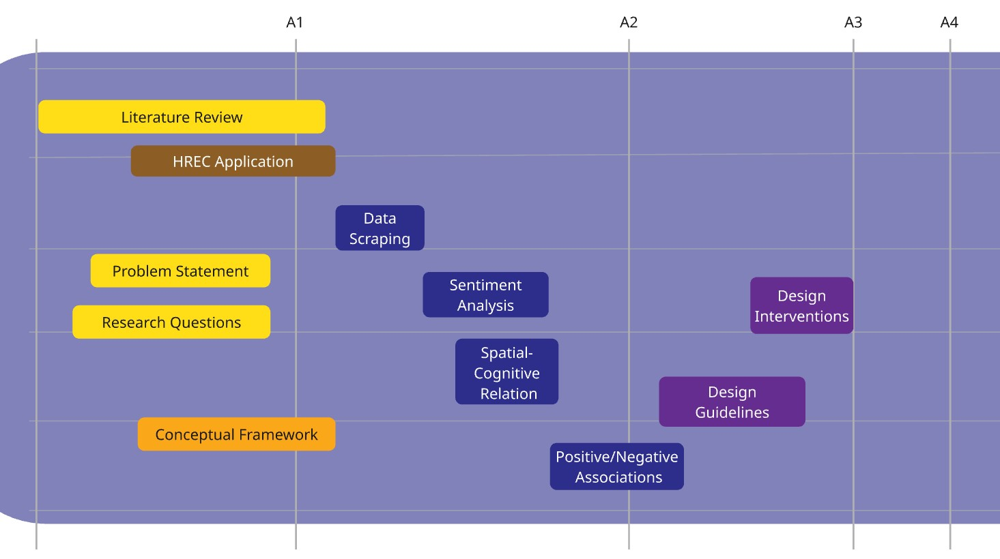

# **Urban Digital Memory: A tool to evaluate spatial interventions in public space - a study of Teatré Shahr Square, Tehran**

*Keywords (draft): Digital Memory, Right to the city, Social Media, Public Engagement, Digital Participation*

# **List of Contents**

-   [Introduction]

-   [Problem Statement]

    -   [Problem in a sentence]

-   [Research Objectives]

-   [Research Questions]

-   [Scope (Case Study)](#scope-case-study)

    -   [Teatré Shahr (City Theater)](#teatré-shahr-city-theater)

    -   \[X and Instagram\]

-   [Literature Review (Relevance)](#literature-review-relevance)

    -   [Right to the memory as a right to the city]

    -   [Digital era (archival memories)](#digital-era-archival-memories)

    -   [Public Engagement (digital participation)](#public-engagement-digital-participation)

-   [Conceptual Framework]

    -   [Framework]

-   [Methodology (methods and planning)](#methodology-methods-and-planning)

    -   [Methodological Framework]

    -   [Expected Outcomes]

    -   \[Project Timeframe\]



# Introduction

Urban environments have always been transforming across different eras. The transformations caused by designers and planners have undergone a metamorphosis, starting from blueprints to co-design with citizens [@arnstein2019; @horelli2024; @mueller2018]. In the past few years, social justice approaches have amplified the focus on engaging the public in urban interventions. However, not all countries have a democratic structure to do so.

Iran is a country in western Asia, often considered part of the Middle East. The city of Tehran is the capital, with a population of nearly 9.7 million in 2025 [@macrotrends]. A dense urban area with hustle and bustle in its city center and various commercial, cultural, and official activities. The city is divided into 22 districts governed by the main municipality, and each district has its own subset of local government organised by the central municipality. Within each district, there are several neighborhoods, the smallest official divisions, also governed by the district municipality through community development offices in direct contact with the local communities. However, this connection is not active.

{width="451"}

{width="448"}

{width="446"}

In countries like Iran, despite following the theories and works of citizen engagement in academia, the practice is far behind this mindset. Many urban development projects are implemented with a top-down approach, regardless of who is responsible. Whether a contractor, developer, designer, planner, or policy maker, none ever approached the public for their opinions on an urban project. There are minimal practices that tried to include citizens within their work by running surveys or interviews. Nevertheless, the number of participants has barely met the needs of the affected population, which looked more like manipulation [@arnstein2019]. The planning and design approaches in countries with less democratic political systems would yield the least successful public engagement through their processes.

Although active participation has never been easy, tools and platforms have made the process smoother for both parties. In the digital era, many citizens have access to online social platforms where they can usually speak up for themselves, with the chance that their opinions could be heard nationally and even globally. In such an era, Iran is not an exception either. Although Iranians have filtered internet access, they use VPNs to bypass the restrictions and access the free internet, sharing their opinions, voices, cries, compliments, memories, and other experiences that are inaccessible on online social networks.

This new accessibility can be considered as a shortcut to democracy. Sharing news and posts about urban spaces is an ongoing phenomenon that goes beyond a single media post with a caption. It can be seen as acknowledging a new space, or, conversely, as downgrading a new intervention in the city. The background of a city can now be traced through online platforms run by individuals who captured it over time. This doesn't end with the past of urban spaces, but also with how urban spaces change in real time, which would have its own responses. How citizens react to an urban project is evident on social media, and how they perceive the transformed urban space is evident as well. The urban space is not just a physical or mental entity; it's also digital.

This study aims to examine how citizens' lived experiences shared on social media formurban digital memories. The digital memory creates new concepts on top of the right to the city notion, which can be called the right to the memory. **The project focuses on how the right to the memory can serve as a significant tool for validating urban interventions in spatial features through a digital public engagement and participation perspective.**

## City Theater of Tehran (Teatré Shahr-e Tehran)

One of the public squares that has always been under intense tension between its users and those who want to change it isCity Theater[^1] Square[^2]. As can be seen in (Fig. x), the square is in the intersection of Vali’asr and Enghelab streets, which are the longest NS / EW armatures of Tehran. The space is located in District 11 of Tehran's municipality (Fig. 4).

[^1]: Teatré Shahr in Persian \[Translated by the author\]

[^2]: The square holds the city theater building within its space, which could be considered a semi-open public space in Tehran, with all of the activities and events that take place downtown.

{width="512"}

The City Theater Square holds one of the oldest theaters in Tehran, dating back to the 1970s. The City Theater of Tehran building was built as an art and cultural complex. City Theater was not only a venue but also a taste of contemporary design inspired by Iranian architecture[@wikipedia2026; @mohit2026]. The presence of the building and its surroundings formed a public space, as the complex was ready for productive use.

*](images/20260121_183415.jpg){width="464"}

The City Theater used to look like a complex with its specific plaza in front of the theater's main building entrance (Fig 5). The current Daneshjoo park, neighboring the Theater's building, was larger than it is now, covering the northern side of the City Theater that touches Enghelab Street. Based on the documentation of a user who shared the aerial image on X (formerly Twitter), the spatial layout in the image is the earliest and most original spatial intervention in this space.

{width="511"}

{width="508"}

As shown in Figs. 6 & 7, the building and the plaza surrounding it have undergone many transformations, including changes in spatial composition, accessibility, mobility, vegetation, and urban furniture. City Theater Square has always been a central point of the daily urban life of Tehran. Moreover, the square has been the ground of various social and political events since its establishment.

{width="534"}

The City Theater plaza has undergone several transformations over the decades (Fig. 8). Various small- and medium-scale interventions have been implemented within its space, from removing statues to constructing the underground path, pedestrian access, and the metro station entrance. Some of these transformations are traceable through Google Earth's satellite imagery. However, the satellite images have been captured since the 2000s. Yetthey make significant spatial interventions, whether inside the plaza or outside, around the square and the main streets of Tehran.

# Problem Statement

There are urban spaces, specifically, public spaces that hold a large pool of collective and individual memories within them, either tragic, joyful, or revolutionary [@solnit2009]. City Theater's Square[^3] is not an exception. However, the public apparently doesn't have any right or authority over the space and its memories as common property. Some spaces are manipulated, transformed, or even demolished by governments, driven by economic or political interests[@paccoud2016; @solnit2001]. An example could be the Haussmannian boulevards, which demolished existing urban streets, creating wide, long boulevards lined with luxury retail shops and police to oppress any citizen opposition in the most dominant way possible[@harvey2006]. All of the valuable memories and the space known to the public were lost in the blink of an eye [@solnit2001]. The citizens don't have any agency over the spaceor its corresponding memory to make decisions, or at least to be clearly informedabout the interventions and changes made by the actors on the higher ground. Not only to the actors but also to the decision-makers; this also applies. Right to the memory is a metaphor of collective/individual rights over space tied to memories that emerge within it. This represents a bond between the space and its dwellings and visitors, shaped by memories, emotions, presence, and activities that have shaped each person's lived experience in that space. Nevertheless, this connection is taken for granted by the actors, designers, policymakers, and governments holding the upper hand in power. Sometimes it's even ignored by them, or it conflicts with their main interests.

[^3]: Teatré Shahr in Persian \[translated by the author\]

The memory is a valuable lived experience that holds evidence of a physical space, conceived and perceived by each individual [@shaw2017]. The cognitive perception of space, recorded on an open platform that can be shared with others, has been discussed in the literature. As @solnit2001 aesthetically showcases the typicality in urban daily life that may be only engraved in literature, it can emerge in the digital space as well. Social media can store individuals' most typical daily routines, written by them, like a diary.

_2024.jpg){width="454"}

{width="461"}

The spatial transformation of City Theater's plaza is ongoing. In the past two years, City Theater faced one of the most drastic transformations since its establishment. It was when a long fence divided the adjacent pathways in the southern street and limited pedestrian access to the square (Fig. 9). A redevelopment project began, with the objective of redesigningCity Theater's plaza. As a matter of fact, no citizen was aware of this project until its design proposal was shared with the public. The design proposal depicted a completely new spatial layout for the plaza. And, as part of the reconstruction, a part of the central space was demolished (Fig. 10). As soon as the public found out about the intervention, they reacted immediately by writing Tweets, consisting of dissatisfied or even angry opinions mentioning how precious the fountain and the plaza were to them, and that was easily transformed without even asking about it.

The citizens expressed their concerns to the officials and the municipality regarding the fence placement and the City Theater's renovations on social media. However, the reconstruction project is ongoing, and its end date remains unknown to the public. The users shared some images of redesign proposals for the plaza and directly addressed the matter of fence placement around the City Theater.

Even some users brought up the artistic and cultural legacy that the City Theater has brought up since its foundation, with images of old newspapers in the 1970s announcing the famous plays being performed at the City Theater of Tehran (Fig. 11). This can reflect how prestigious the City Theater space is to the public, how its preservation is critical as a cultural and social heritage.

These are some examples of how the public encounters spatial interventions through digital spaces to archive, review, evaluate, or express, keeping themselves engaged with their city and urban life when their voices are not actively heard.

#### Problem in a sentence

Spatial memories are valuable insights into a space that are taken for granted by designers/decision-makers in their interventions, leading to the erasure ofpublic space.

# Research Objectives

In the era in which digital media has a vast impact on urban lives, it even becomes an autonomous memorial archive [@haskins2007]. Having such a large-scale, individual lived experience from citizens would help gain a better understanding of citizens' reviews of urban environments. Also, it's not only about opinions but about how they experienced the space individually or collectively. This is a helpful step towards planning and designing projects.

Also, within the right to the city notions [@harvey2003; @lefebvre1968], it was discussed that memories of a space that holds dozens of lived experiences from various individuals or groups turn the space into a valuable environment, a place [@martin2025]. Having a place is not limited to its physical existence, but also to how it's cloned in the memories of those who interacted with it. This would be the link between having the right to the city and having the right to the memory.

Having already expressed opinions or archived memories on open, accessible platforms would aid designers and planners in studying a citizen perspective and eventually find more efficient strategies for public engagement [@williamson2020]. The digital memory may not be the final solution, but it will be a key starting point for many urban transformations aiming to be more inclusive and plural.

The objectives can be defined as follows:

1.  Public engagement increases via virtual spaces (online digital platforms)
2.  Inclusive design and planning
3.  Digitally shared lived-experience validation as digital memories (right to the memory)
4.  Design / Planning through urban data

# Research Questions

## Main Question

**How can digital memories shared by citizens help identify spatial values as potential conditions for interventions in Teatré Shahr Square?**

### Sub-questions

1.  How do digital memories narrate the lived experiences of citizens in the City Theater square on X (former Twitter) and Instagram?

2.  What emotions can be traced from digital memories of City Theater Square?

3.  What spatial qualities could be referred to from the shared emotions of City Theater Square?

4.  What spatial values do citizens share about the City Theater square space transformation throughout time (before and after the latest intervention) as reflected on social media?

5.  How can shared memories on social media inform design guidelines for the City Theater Square?

To clarify how each sub-question will be addressed, the corresponding methodology is briefly described in the following table.

+---------------------------------------------------------------------------------------------------------------------------------------------------------------------------------------+--------------------------+------------------------------------------------------------------------------------------------------------------+
| Question                                                                                                                                                                              | Type of analysis         | Methodology                                                                                                      |
+:=====================================================================================================================================================================================:+:========================:+:================================================================================================================:+
| 1.  How do digital memories narrate the lived experiences of citizens in the City Theater square on X (former Twitter) and Instagram?                                                 | Descriptive / Analytical | Literature review,\                                                                                              |
|                                                                                                                                                                                       |                          | Data collection using scraping apps as strings of text, Topic modelling                                          |
+---------------------------------------------------------------------------------------------------------------------------------------------------------------------------------------+--------------------------+------------------------------------------------------------------------------------------------------------------+
| 2.  What emotions can be traced from digital memories of City Theater Square?                                                                                                         | Descriptive / Analytical | Sentiment analysis to recognize and classify emotions from texts extracted from Tweets and Instagram posts       |
+---------------------------------------------------------------------------------------------------------------------------------------------------------------------------------------+--------------------------+------------------------------------------------------------------------------------------------------------------+
| 3.  What spatial qualities could be referred to from the shared emotions?                                                                                                             | Descriptive / Analytical | Locating the spatial features referred to by emotions through cognitive indicators                               |
+---------------------------------------------------------------------------------------------------------------------------------------------------------------------------------------+--------------------------+------------------------------------------------------------------------------------------------------------------+
| 4.  What spatial values do citizens share about the City Theater square space transformation throughout time (before and after the latest intervention) as reflected on social media? | Normative                | Classifying the values of spatial features referred to by emotions into positive and negative                    |
+---------------------------------------------------------------------------------------------------------------------------------------------------------------------------------------+--------------------------+------------------------------------------------------------------------------------------------------------------+
| 5.  How can shared memories on social media inform design guidelines for the City Theater Square?                                                                                     | Normative                | Creating design guidelines based on spatial qualities and interventions corresponding to negative spatial values |
+---------------------------------------------------------------------------------------------------------------------------------------------------------------------------------------+--------------------------+------------------------------------------------------------------------------------------------------------------+

: *Table 2. Sub-questions classification and methodology*

------------------------------------------------------------------------

# Scope (Case Study) {#scope-case-study}

## City Theater Plaza {#teatré-shahr-city-theater}

The reason for choosing this specific public space is not only its architectural quality, but also its historical legacy, which holds many urban events, activities, and daily-life patterns. A public space at the heart of the Iranian capital, Tehran, has always been a focal point for its dwellers.

Thus, it holds a large scale of digital memories within itself, which it collects and studies. Also, because there is no explicit online platform for citizens to share their digital memories of a specific urban space, the current study focuses on the most popular and recognized public space. This will increase the likelihood of related data being available and collected.

## X and Instagram[^4]

[^4]: Since the mentioned social media platforms are officially banned in Iran, there aren't precise data or information regarding the user accounts in Iran. The current descriptions are based on the author's experiences who was born and raised in Iran using the mentioned social media platforms that are popular among the existing internet users who access them via VPNs that change their IP addresses in Iran.

Multiple social media platforms hold vast amounts of data about digital memories. In the Iranian case, users are mostly active on the two platforms, X (formerly Twitter) and Meta's Instagram. The X has always been one of the most dynamic platforms for Iranians to share their opinions on the state of the country and their daily lives. Instagram is the most popular social media platform among Iranians, with a 28.33% share, and X holds 5.4% over the last decade (Dec 2015 - Dec 2025) [@statcounter]. X may not be the most popular platform, but it's where many users share their opinions on critical or general topics more straightforwardly and transparently. While other platforms like Instagram, Facebook, or Pinterest focus on sharing media and general descriptions, X would offer more textual content that conveys a stronger sense of individual or professional positionality regarding a topic.

Based on these reasons, X and Instagram are chosen as the targeted social media platforms to collect their digital memories of City Theater Square and to analyze the textsin tweets and Instagram posts.

------------------------------------------------------------------------

# Literature Review (Relevance) {#literature-review-relevance}

### Right to the memory as a right to the city

The Right to the City was coined by the French philosopherHenri Lefebvre in the era when social movements became viral among young intellectuals and labor activists seeking social justice in urban areas [@mitchell2003]. After Modernism, the ownership of land in urban areas through capitalist monopoly expanded dramatically. At that time, politicians, social activists, urbanists, and philosophers realized the need for a just city and a healthy environment between the city blocks is something crucial and, in other words, could be considered a right for the citizens who live in there and use its space [@habibi2016; @harvey2015; @lefebvre1968].

Furthermore, the notion was developed by @harvey2015, who argued that city dwellers can fight for their rights over space and, more generally, over the city. This act works against the manipulation and trespassing in the public domain by private developers and governments who attempt to impose capitalism across vacant spaces for profit. @harvey2015 suggested that the public could prevent this through social activities and demonstrations by recognizing the Right to the City as their individual will to change their living space and ultimatelythemselves. Thus, the Right to the City is mostly interpreted as the right to public space. Who has access to it and who doesn’t defines this right [@harvey2015; @habibi2016; @moroni2014].

Suppose we consider the right over public space derived from the concept of the right to the city. Once people have lived experiences in a space, it forms their memories of that space. Since memory and physical space can be imagined as intertwined, memories are attached to physical space. In contrast, the space holds the memories within its boundaries(notions of sense of place, etc.). Thus, having the right to a public space automatically grants the right to its memories at the same time. In other words, policy makers, designers, or any other entity that holds the authority or power to change the space must take into account the sensitivity of a public space, not only based on general spatial values and qualities, but also on memories embedded in that space. It should be acknowledged that citizens have a right to the space and to their memories of it as common goods, too.

Based on the same theoretical principles, Harvey (1993) has always discussed the right to the city as extending beyond mere access toresources [Harvey (1993) as cited in @tedeschi2024].

The abstract space described by Lefebvre (1991), limited to planning and design perspectives, has changed into a rapid representation in various forms through digital information. The space is no longer an abstraction of a physical entity; it is regenerated and transformed in a digital domain based onrapidly changing information [Lefebvre (1991) as cited in @shaw2017].

The technological development has brought new definitions of the right to the city concept. @tedeschi2024 argues that algorithms have a right to space, as they rapidly produce and update information about physical space. This makes the accessibility and experience for its dwellers either disruptive or reinforcing, leading them to negotiate their social interactions and power over space with this non-human entity. This creates a different level of inequality in a digital dimension.

### Digital era (archival memories) {#digital-era-archival-memories}

In the digital age, the media has become a tool for any individual to express their thoughts, share their feelings, raise ideas, share experiences and memories, or cry out for their rights as critical matters. One major feature of digital media is their archival potential. They are the database of memories of many individual and collective activities or events in a variety of contexts.

What archival memories can bring is not comparable to a curated, centrally organised museum set up exclusively for visitors, but to an independent, multi-voice platform that anyone with a digital device can share and publish to other users throughout the internet [@haskins2007]. Even such an idea was suggested by Lefebvre (2003, as cited in @tedeschi2024): having a self-management feature on a digital platform should be a right, even though it was considered a right to urban resources rather than something higher.

The importance of the digital domain is not just about having horizontal archival memories created by numerous individuals, but about the digital space itself as a phenomenon that can trace the contents of a society in a physical space. @shaw2017 [pp. 909] brings up the importance of data flows in urban studies:

> "*Just as the urbanization of water is a processional notion which can uncover 'stories about the city’s structure and development', so can a reading of the city’s 'political, social, and economic conduits' through which information flows also “carry the potential for an improved, more just, and more equitable right to the city”*"

The data flows of urban life have the potential to reflect many aspects of the city's dynamics, struggles, and synergies throughout its history. Not only the past, but also, thanks to real-time communications, the present state of the city. @solnit2001 [pp. 91] also points out the historical importance of urban space, or more precisely, the streets, as *"repositories of history"* that are lived in. The lived experiences within these repositories can be shared and recorded on social networks as valued, recognized spaces that hold history.

### Public Engagement (digital participation) {#public-engagement-digital-participation}

Again, from the right to the city, @mitchell2003 highlights the right to the city, which is *oeuvre*[^5], a piece of art, that each citizen contributes to [@tedeschi2024, pp.3]. It is a piece of art, like a tapestry, with which city dwellers can create by sharing their lived experiences and turn those experiences into action [@tedeschi2024, pp.6; @currie2022; @martin2025]. Taking citizens' lived experiences and emotions into account in the planning and design process would lead to a valued space, or the so-called place [@martin2025]. Moreover, public participation has always been better received in urban projects, regardless of their effectiveness [@martin2025].

[^5]: A piece of art \[in French\]

Even reframing the Right to the City leads to co-design from a governmental perspective to shape public space rather than just having citizens gain more power and rights over their space [@tedeschi2024].

Based on the notions explained about archival media, autonomous authorship would lead todemocratized media [@haskins2007; @martin2025]. This can be recognized as the first steps towards public participation before engaging the stakeholders, mostly citizens or vulnerable groups. To understand the extent of participation, @arnstein2019 proposed the concept of "The Ladder of Participation," which describes the levels of public engagement and participation as a ladder with progressively higher levels. The ladder starts with the least level of participation, known as Therapy, and culminates in the ultimate form of active citizen engagement in the design process.

Based on @arnstein2019's ladder of participation, having citizens' shared lived experiences on digital platforms may be a lower step, yet a passively engaging position that needs updating. Because this is not about the planner/designer's active interaction with citizens, but about reading or tracing citizens' emotions from an autonomous, semi-survey publicly available [@martin2025].

One positive aspect of having the digital inputs is the large scale of data. Despite usually having a limited number of active participants in urban projects, digital platforms offer the opportunity to gather qualitative insights from a broader range of citizens[@martin2025; @fathullah2018].

Digital participation is also supported by various studies [@martin2025; @haskins2007]. Also, @williamson2020 points out a further step: using social media data on a participatory scale. They suggested the term 'Frontloading', which refers to engaging stakeholders in the early stages of planning by accessingshared emotions and experiences on social media. (Read through #MySydney case)

------------------------------------------------------------------------

# Conceptual Framework

The conceptual framework will help identify the necessary criteria for running sentiment analysis on the collectedtext strings from the targeted platforms. The conceptual framework is based on the principles derived from the literature review, considering the spatial qualities that shape how a space evokes memories and lived experiences for citizens when they interact with it. And, how this can be identified and classified through semantic analysis of string data on online platforms.

The initial concept would be the transformation of space into place through people's interactions, which shape their sense of belonging to their environment based on several spatial and contextual factors [@martin2025].

The belonging factors can be identified in Fig. 4 below, which represents a very initial draft of the spatial and contextual aspects that would have a direct and indirect impact on one's sense of belonging to the environment in which they have been and interacted.

-   Ecology: green & blue elements, living species

-   Accessibility: sidewalk, pathways, entrances, gateways

-   Openness: open space, tiling, profile details

-   Sitting space: edges, fountain, benches

-   Landmarks: City Theater building, statues, and a fountain

-   Visibility: Eye view sheds, landmarks, corridors,

-   Safety: pedestrian priority, traffic control

-   Security: active presence, observer eye (eyes on the street)

-   Geography: topography, location

-   Climate: temperature, humidity, sun angle

-   Identity: symbols, culture, language, lifestyle

The memories of space or place that are turned into lived experience and expressed through emotions in digital space are useful for analyzing a space from a cognitive perspective.

Users share different experiences of their presence and interactions within the lived space on social media. As mentioned before, their posts and tweets would hold various emotions. The main gap is how to trace the spatial feature from these shared emotions.

Thanks to @lynch1964's cognitive analysis concepts and methods of the perceived space or city, the spatial features could be tracked and recognized by how the individuals described their situation or position of the space, and their mentions could be classified into Lynch’s cognitive features of nodes, lines, areas, edges, and landmarks. The subsequent workflow would focus on relating different sentiments to their corresponding spatial features in the context. For example, someone could have gotten angry due to the presence of edges in a specific area.

The sentiment classification of each feature would help identify valuable places and how they were designed, with a corresponding design for the public that results in livability and placemaking. Also, spaces that need improvement will be identified. Based on the feelings that address the specific feature, the association between physical space and emotions in memory will result in positive or negative values. This would help with the further steps of the design process and with producing spatial conditions in spaces that hold memories that can be recalled as a public good.

## Framework

Furthermore, to integrate the adapted concepts from the literature review, as a guiding theme for the research and design process, a conceptual framework was illustrated in the following diagram.

{#conceptual_frame}

The diagram depicts the three main concepts of the study, social media, digital memory, and space, and how they are related to each other based on the defined methods and processes.

### Definitions and processes

**Space:** The existing physical space that, in this case, can be considered as the public space, or to be precise, City Theater's plaza in Tehran, which holds various activities, spatial elements, and mobility within. Users of social media interact with the space. The result of this interaction is expressed in another sphere by them.

**Social Media:** Social media is a fragment of a larger sphere, the digital space, that includes many other domains with various activities, characteristics, and users. The study's focus is on social media platforms (i.e., X & Instagram) where users share their expressions, opinions, attachments, and, in general, their lived experience of the space as a memory. These memories are shared as Tweets and Instagram posts with footage, images, or plain descriptions. These data will be scraped from their platforms as text strings (only the textual contents) that address the space with the keywords City Theater or City Theater's intersection to be collected.

**Digital Memories:** The scraped and collected data are literally the memories of the space in the past (or, as it is called, the past space). Any of the memories refers to the space. But that's not all of the input. Each of them holds a specific expression, for it is a personal experience. The various memories can be classified by how they were expressed, along with one or more emotions.

**Extracted Emotions:** The emotions within digital memories can be extracted and classified using sentiment analysis. The emotions in digital memories will be identified from textual expressions. Each word or phrase addresses a feeling or experience that can be classified into the following items:

1.  Anger

2.  Sadness

3.  Comfort

4.  Happiness

Having these classes, the emotions can be categorized as negative or positive feelings.

+---------------------+----------------------+
| Emotion Categories  | Value Classification |
+:===================:+:====================:+
| Anger               | Negative             |
+---------------------+----------------------+
| Sadness             | Negative             |
+---------------------+----------------------+
| Comfort             | Positive             |
+---------------------+----------------------+
| Happiness           | Positive             |
+---------------------+----------------------+

: *Table 3. Categories and Classifications of Emotions*

**Spatial Features:** Based on @lynch1964 's perceptual urban elements, each shared emotion would have one or more corresponding spatial features that affected the person's cognition and co-created their lived experience. The features are as follows:

1.  Path
2.  Node
3.  Edge
4.  District (areas with common character)
5.  Landmark

{#lynch_elements width="400"}

The urban elements are addressed, directly or indirectly, by users in their digital memories. This addressing comes with an evaluation of their emotions towards the spatial features. Based on this and the extracted emotions, the negative and positive ratings can be linked to the corresponding urban elementsrecognized mentally by the valuers. This relational process helps create positive or negative associations within the space.

**Positive/Negative Associations:** The associations made through the relational process will reveal spatial features with negative or positive values. Features with negative ratings require improvements and interventions. While the ones with positive ratings might have design qualities to be recognized, preserved, or reused through interventions within the space, the original context of this study is.

Overall, as shown in [Fig. 15](#conceptual_frame), the cycle can continue in the original space after the interventions based on positive/negative associations are applied. The transformed spatial features within the space can make an impression on their valuers, shaping their lived experience of the space again. Therefore, as impressions accumulate, a sense of place builds as it moves through the space and its elements. The impressions emerge in different forms, such as Tweets and Instagram posts, regarding the physical space sphere. In that way, the impressions of the physical space are transferred to the digital space (i.e., social media) and create a clone of the existing space.

The past, the transforming, and the existing space are not shaped onlymentally. But also, that mental recognition of space is represented in social media, shared within the digital space.



# Methodology (methods and planning) {#methodology-methods-and-planning}

The main target is to collect data from posts and tweets shared by public profiles on Instagram and X (formerly Twitter). The analysis will focus on the latest interventions in City Theater Square. There are pre-intervention and post-intervention phases in which the public shared their opinions, expressions, and impressions as lived experiences, both when the square was intact and when it was transformed through redesign procedures over the past two years of a time-stretched project [@aleksandar].

The main variable that will be collected is the text strings within tweets on X and post captions on Instagram, using a scraping application specialized for these platforms [^6] considering the legal and regulatory procedures of online scraping. The data collection will follow the specified time frame mentioned previously and usedefined keywords to narrow the search domain as specifically as possible. Names like "Teatré Shahr", "Teatré Shahr square", or "Vali'asr intersection" would be used as keywords to identify and collect any related text data to the chosen case study[@williamson2020].

[^6]: Tweet scraper V2-X for Twitter and Instagram scraper

After that, the data needed to be cleaned of unnecessary details and irrelevant expressions so the analysis could be applied appropriately. The unnecessary details include personal information and opinions on highly sensitive topics that may cause risk to data subjects. The necessary data would include sentiments, spatial features, and memorial expressions related to the space (i.e., City Theater and its surroundings), all in string format. After that, the cleaned data will be classified based on sentiment values derived from the structured conceptual framework, using qualitative content analysis[@williamson2020]. By overlapping the driven criteria with semantically classified data, classified as various expressions of anger, sadness, happiness, fear, etc., the spatial qualities and design guiding values could be shaped or at least frame an overview of what is valuable and should be preserved, and what might be the alternatives of design for such public spaces.

## Methodological Framework

Based on the above-mentioned notions and theoretical backgrounds, the conceptual framework is structured, serving as a theoretical lens for the methodology and subsequent steps of this study. The details and connections of each notion are illustrated in the following figure.

{#method_framework}

Starting with social media, the data in Tweets and Instagram posts is rooted in the virtual digital space and can be traced back todigital memories. That is the second sphere, which holds the lived experiences within the texts, extracted as emotions using sentiment analysis. Four main considered emotions also refer to spatial features that can be identified using the cognitive approaches. The space is perceived as simple objects such as lines, nodes, and landmarks. Not only do the emotions address each spatial feature, but they also evaluate it. There are physical elements that may have negative effects (Angry or Sad) or positive effects (Happy or Comfortable) on people experiencing their interaction with the space, and they rate them by expressing emotionsstored as digital memories.

After relating each emotion to its addressed physical elements within the space, emotions such as anger or sadness can be considered spaces that do not properly correspond to the public. Thus, they may need spatial improvements or interventions. The second approach would focus on spaces that evoke happiness or comfort among users on social media. Those spaces are already public spaces and contribute to the space's livability. They can be considered valuable spaces, while their spatial characteristics should be processed and applied as design qualities in spaces that do not possess the same qualities within Teatré Shahr square. All of this process happens within its context, which is Teatré Shahr in this case, and each step has interrelations with the environment chosen as the study area. Hopefully, in the design steps, the relationship would be circular rather than one-way and more interactive.



## Expected Outcomes

The expected outcomes are considered to be either the results of data analysis, spatial design guidelines, or interventions on the case study, aka Teatré Shahr square.

{#expected_outcome width="500"}

The outcomes would be categorized into results of sentiment analysis of text strings collected from tweets, serving as an archive of emotions, along with their linked spatial features, matchedbased on cognitive indicators of urban space perception. This leads to valuing spatial features based on emotions as eithernegative or positive elements within the space. These values will be localized based on their in-text descriptions of the space in the form of hand drawings, map drawings, and images generated via xFigura [^7].

[^7]: An AI assistant platform meant for architectural design and presentation

On the spatial category, the outcomes are followed up on the analysis outputs. The design guidelines would be the first step in addressing the challenges, creating concise, straightforward guidelines for the public space that can also serve as a general design framework. After that, some detailed interventions, following the structured guideline, will be demonstrated using hand drawings, plans, sections, or bird's-eye-view drawings of the integrated design work. These outcomes will be presented as integration of manual drawings and AI-generated images, such as xFigura.



## Project time frame

{#timeline}

# References
