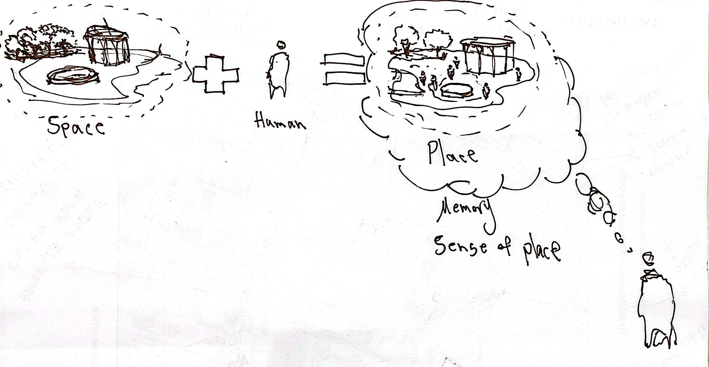
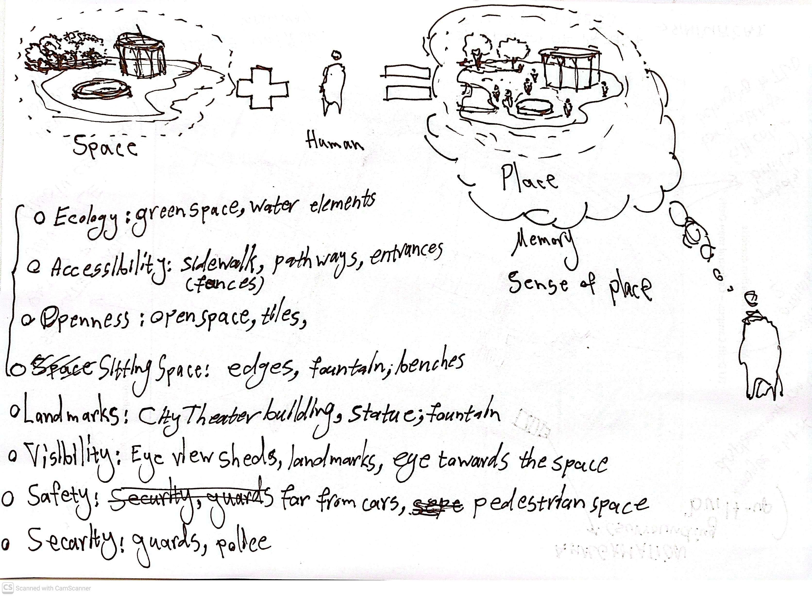

# **Urban Digital Memory: A tool to monitor / evaluate spatial interventions over the public space - a study of Teatré Shahr sqr., Tehran**

*Keywords (draft): Digital Memory, Right to the city, Social Media, Public Engagement, Digital Participation*

# Introduction

# Relevance

### Right to the memory as a right to the city

If we consider the right over public space derived from the concept of the right to the city. Once people have their lived-experiences on a space, it forms their memories of that space. Since memory and physical space can be imagined as intertwined existences, the memories are attached to the physical space while the space holds the memories within its boundaries as well (notions of sense of place etc.). Thus, having the right over a public space, automatically gives the right to the memories towards it at the same time. In other words, policy makers, designers or any other entity that holds the authority or power to change the space has to take into account the sensitivity of a public space not only based on general spatial values and qualities, but also with memories embedded within that space. It should be acknowledged that citizens have a right to the space, and they have right to their memories of that space as common goods too.

### Digital era (archival memories)

In the digital age, the media has become a tool for any individual to express their thoughts, talk about their feelings, bring up ideas, share experiences and memories or cry out for their right as critical matter. One major feature of digital media is their archival potential. They are the database of memories of many individual and collective activities or events in a various set of contexts.

What archival memories can bring is not comparable to a curated, centrally organised museum set up excluded to visitors as the audience, but an independent multi-voice platform that anyone holding a digital device can share and publish to other users throughout the internet (@haskins2007).

### Public Engagement (digital participation)

# Research Objectives

# Problem Statement

There are urban spaces, specifically, public spaces that hold a large pool of collective and individual memories within them, either tragic, joyful or revolutionary. However, the public apparently doesn't have any right or authority over the space and the memories within it as a common property. There are spaces that get manipulated, transformed or even demolished by government enforced by economic or political interests. The citizens don't have any agency over the space to make decision or at least to be informed clearly about the interventions or changes made by the actors on the higher ground. Not only with the actors, but also with the decision makers this applies too. Right to the memory is a metaphor of collective / individual rights over space tangled to memories emerged within it. This represents a bond made between the space and its dwellings and visitors by memories, emotions, presence and activities that shaped each person's lived-experience in that space. Nevertheless, this connection is taken for granted by the actors, designers, policy makers and governments holding the upper hand of power. Sometimes it's even ignored by them or does conflict with their main interests.

The memory is a valuable lived-experience that holds evidences of a lived, conceived and perceived physical space for each individual (@shaw2017).

Traces of urban space transformation through digital memory.

#### Problem in a sentence

The spatial memories are valuable intakes of a space that are taken for granted by the designers / decision-makers in their interventions causing erasure of the public space.

# Research Questions

**How can digital memories shared by citizens help identify spatial values as potential guidelines (regulations) for interventions in Teatré Shahr Square?**

1.  How the memories of Teatré Shahr square shared on social media can raise public awareness regarding the redesign projects that affect it as a public space?

    1.1. What spatial values do citizens share about the City Theater square space transformation throughout time (before and after the latest intervention) as reflected on the social media ?

2.  How can digital memories of a physical space can define intervention limits as valuable spatial features for policy-makers and designers?

    2.2.How can social media help as a passive-digital-participatory platform to identify the valuable spaces within the square (meeting spots, sitting spaces, open frontage of City Theater building) in terms of right to the memory(city)?

3.  How spatial interventions can be assessed and evaluated through analyzing the digital memories concerning a public space? #not sure about this question yet.

    3.1. How recurring emotions and experiences expressed by the citizens on social media reflect the sensitivity of specific locations (sitting spaces, fountain area, frontage space of City Theater building, meeting spots) within the square?

4.  How do digital memories narrate the lived-experiences of citizens in the City Theater square and how do these narratives indicate which spatial features should be preserved? \# in the support of identifying boundary-sensitive areas

# Scope (Case Study)

One of the public squares which has always been under drastic tension between its users and the ones who want to change it is the City Theater^[\[1\]](#_ftn1)^ square[\[2\]](#_ftn2). As can be seen in (Fig. 2), the square is in the intersection of Vali’asr and Enghelab streets which are the longest vertical and horizontal armatures of Tehran.

^[\[1\]](#_ftnref1)^ Teatré Shahr in Persian \[Translated by the author\]

[\[2\]](#_ftnref2) The square holds the city theater building within its space that could be considered as a semi-open public space in Tehran with all of the activities and events that take place downtown.

------------------------------------------------------------------------

# Methodology (methods and planning)

The main target is to collect the data from posts and tweets shared by public profiles through social media platforms of Instagram and X (former Twitter). The analysis frame will be concentrated on the latest interventions happened to the City Theater square. There are pre-intervention and post-intervention phases in which public shared their opinions, expressions, impressions as lived-experiences when the square was intact versus when it was transformed through re-design procedures in the past two years of a time-stretched project.

The main variable that will be collected is the text strings within tweets and post captions on Instagram using scraping application specialized for these platforms considering the legal and regulatory procedures of online scraping. The data collection will follow a specified time-frame mentioned before and defined keywords to narrow the search domain as specific as possible. Names like "Teatré Shahr", "Teatré Shahr square" or "Vali'asr intersection" would be used as ques to locate and collect any related data to the chosen case study.

# Theoretical Framework

------------------------------------------------------------------------

The initial conceptual framework will help to extract necessary criteria to run the semantic analysis on collected data text strings from the targeted platforms. The conceptual framework is based on the principles driven out in the literature review considering the spatial qualities of how a space would picture memories and lived-experiences of citizens when they interact with it. And, how this can be identified and classified through semantic analysis of string data on online platforms.

The initial concept would be the transformation of space to place through people's interactions that shapes sense of belonging towards their environment based on several spatial and contextual factors.

The belonging factors can be identified as below in Fig. 4 which represents a very initial draft of spatial and contextual aspects that would make direct and in-direct impact of ones sense of belonging towards the environment in which they have been to and interacted within it.

-   Ecology: green & blue elements, living species

-   Accessibility: sidewalk, pathways, entrances, gateways

-   Openness: open space, tiling, profile details

-   Sitting space: edges, fountain, benches

-   Landmarks: City Theater building, statues, fountain

-   Visibility: Eye view sheds, landmarks, corridors,

-   Safety: pedestrian priority, traffic control

-   Security: active presence, observer eye (eyes on the street)

-   Geography: topography, location

-   Climate: temperature, humidity, sun angle

-   Identity: symbols, culture, language, lifestyle
