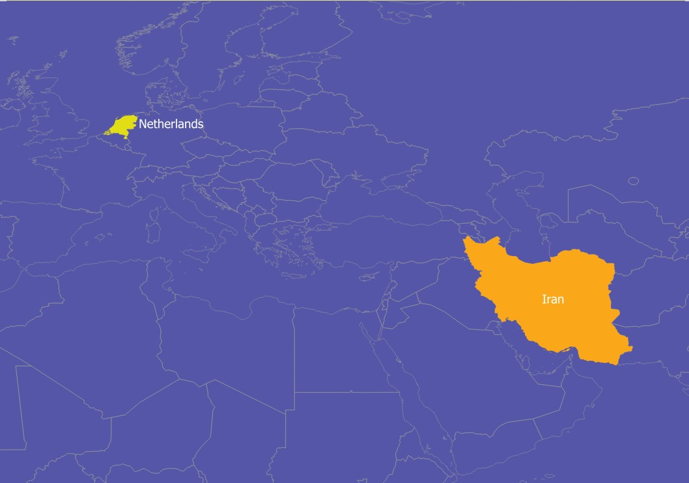
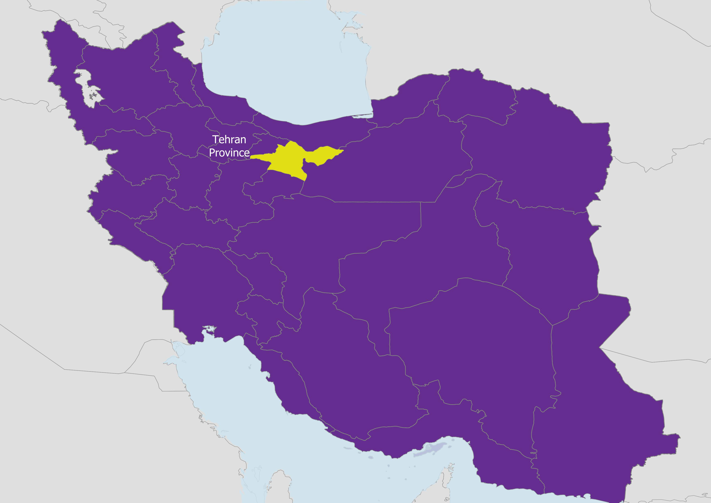
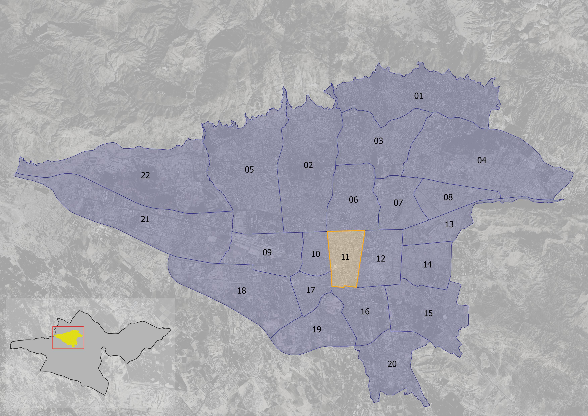

# **Urban Digital Memory: A tool to evaluate spatial interventions in public space - a study of Teatré Shahr Square, Tehran**

*Keywords (draft): Digital Memory, Right to the city, Social Media, Public Engagement, Digital Participation*

# **List of Contents**

-   [Introduction]

-   [Problem Statement]

    -   [Problem in a sentence]

-   [Research Objectives]

-   [Research Questions]

-   [Scope (Case Study)](#scope-case-study)

    -   [Teatré Shahr (City Theater)](#teatré-shahr-city-theater)

    -   \[X and Instagram\]

-   [Literature Review (Relevance)](#literature-review-relevance)

    -   [Right to the memory as a right to the city]

    -   [Digital era (archival memories)](#digital-era-archival-memories)

    -   [Public Engagement (digital participation)](#public-engagement-digital-participation)

-   [Conceptual Framework]

    -   [Framework]

-   [Methodology (methods and planning)](#methodology-methods-and-planning)

    -   [Methodological Framework]

    -   [Expected Outcomes]

    -   \[Project Timeframe\]



# Introduction

The urban environments have always been transforming through different eras. The transformations caused by designers and planners have undergone a metamorphosis, starting from blueprints to co-design with citizens [@arnstein2019; @horelli2024; @mueller2018]. In the past few years, the social justice approaches amplified the concentration on engaging the public in urban interventions. However, not all countries have a democratic structure to do so.

Iran is a country in western Asia, mostly known as the Middle East. The city of Tehran is the capital, with a population of nearly 9.7 million in 2025 [@macrotrends]. A dense urban area with hustle and bustle in its city center and various commercial, cultural, and official activities. The city is divided into 22 districts governed by the main municipality, and each district has its own subset of local government organised by the central municipality. Within each district, there are several neighborhoods, the smallest official divisions, also governed by the district municipality through community development offices that are in direct connection with the local communities. However, this connection is not active.

{width="451"}

{width="448"}

{width="446"}

In countries like Iran, despite following the theories and works of citizen engagement in academia, the practice is far behind this mindset. Many urban development projects are implemented with a top-down approach, regardless of the responsible party. Whether a contractor, developer, designer, planner, or policy maker, none ever approached the public for their opinions on an urban project. There are minimal practices that tried to include citizens within their work by running surveys or interviews. Nevertheless, the number of participators have barely met the satisfaction of the affected population, which looked more like being manipulated [@arnstein2019]. The planning and design approaches in countries with less democratic political systems would have the least amount of successful public engagement through their process.

Although active participation has never been an easy practice, there have been tools and platforms that made the process smoother for both ends. Living in the digital era, many citizens have access to online social platforms where they can usually speak up on their own, with the chance that their opinion could be heard nationally and even globally. In such an era, Iran is not an exception either. Although Iranians have filtered internet access, they use VPNs to bypass the restrictions and access the free internet, sharing their opinions, voices, cries, compliments, memories, and all other experiences inaccessible on online social networks.

This new accessibility can be considered as a shortcut to democracy. Sharing the news and posts regarding urban spaces is an ongoing phenomenon that is more than just a shared media with a caption. It can be seen as acknowledging a new space, or the opposite, downgrading a new intervention in the city. The background of a city can now be traced within the online platforms run by individuals who captured it throughout time. This doesn't end with the past of urban spaces, but also how an urban space changes in real-time, which would have its own responses. How citizens react to an urban project is evident on social media, and how they perceive the transformed urban space as before. The urban space is not just a physical or mental entity; it's also digital.

This study aims to tackle the matter of how citizens' lived experiences shared on social media form as urban digital memories. The digital memory creates newer concepts on top of the right to the city notion that can be called right to the memory. **The project focuses on how the right to the memory can become a significant tool to validate urban interventions on spatial features through a digital public engagement and participation perspective.**

## City Theater of Tehran (Teatré Shahr-e Tehran)

One of the public squares which has always been under drastic tension between its users and the ones who want to change it is the City Theater[^1] Square[^2]. As can be seen in (Fig. x), the square is in the intersection of Vali’asr and Enghelab streets, which are the longest NS / EW armatures of Tehran. The space is located in District 11 of Tehran's municipality (Fig. 4).

[^1]: Teatré Shahr in Persian \[Translated by the author\]

[^2]: The square holds the city theater building within its space, which could be considered a semi-open public space in Tehran, with all of the activities and events that take place downtown.

{width="512"}

The City Theater Square holds one of the oldest theaters in Tehran, dating back to the 1970s. The City Theater of Tehran building was built as an art and cultural complex. City Theater was not only a venue, but also a taste of the contemporary design inspired by the Iranian architecture[@wikipedia2026; @mohit2026]. The presence of the building with its surroundings formed a public space since the complex was ready for productivity.

*](images/20260121_183415.jpg){width="464"}

The City Theater used to look like a complex with its specific plaza in front of the theater's main building entrance (Fig 5). The current Daneshjoo park, neighboring the Theater's building, was bigger than now, covering the northern side of the City Theater that touches Enghelab street. Based on the documentation of a user who shared the aerial image in X (formerly Twitter), the spatial layout in the image is the most original and initial spatial intervention of this space.

{width="511"}

{width="508"}

As can be seen in Figs. 6 & 7, the building and the plaza surrounding it have faced many transformations, such as the spatial composition, accessibility, mobility, vegetation, and urban furniture. City Theater Square has always been a central point of the daily urban life of Tehran. Moreover, the square has been the ground of various social and political events since its establishment.

{width="534"}

The City Theater plaza has been under several transformations over the decades (Fig. 8). Various types of small and medium interventions have been implemented within its space. From removing statues to constructing the underground path, pedestrian access, and the metro station entrance. Some of these transformations are traceable through satellite imagery of Google Earth's engine. However, the satellite images have been captured since the 2000s. Yet, they portray significant spatial interventions, whether inside the plaza or outside, around the square and main streets of Tehran.

# Problem Statement

There are urban spaces, specifically, public spaces that hold a large pool of collective and individual memories within them, either tragic, joyful, or revolutionary [@solnit2009]. City Theater's Square[^3] is not an exception. However, the public apparently doesn't have any right or authority over the space and the memories within it as common property. Some spaces get manipulated, transformed, or even demolished by government enforced by economic or political interests[@paccoud2016; @solnit2001]. An example could be the Haussmannian boulevards that demolished the existing urban streets into wide and long boulevards with luxury retail shops on the sides and policing to oppress any opposition from citizens in the most dominant possible way [@harvey2006]. All of the valuable memories and the space known to the public were all lost in a glimpse of an eye [@solnit2001]. The citizens don't have any agency over the space, and the corresponding memory, to make decisions, or at least to be informed clearly about the interventions and changes made by the actors on the higher ground. Not only with the actors, but also with the decision makers, this applies too. Right to the memory is a metaphor of collective/individual rights over space tied to memories that emerge within it. This represents a bond made between the space and its dwellings and visitors by memories, emotions, presence, and activities that shaped each person's lived-experience in that space. Nevertheless, this connection is taken for granted by the actors, designers, policy makers, and governments holding the upper hand of power. Sometimes it's even ignored by them, or does conflict with their main interests.

[^3]: Teatré Shahr in Persian \[translated by the author\]

The memory is a valuable lived-experience that holds evidence of a lived, conceived, and perceived physical space for each individual [@shaw2017]. Having the cognitive perception of the space recorded in an open platform that can be shared with other individuals has been discussed in the literature. As @solnit2001 aesthetically showcases the typicality in urban daily life that may be only engraved in literature, it can emerge in the digital space as well. Social media has the capacity to store the most typical and daily routines of individuals written by themselves, like a diary.

_2024.jpg){width="454"}

{width="461"}

The spatial transformation of City Theater's plaza is ongoing. In the past two years, City Theater faced one of the most drastic transformations since its establishment. It was when a long fence divided the adjacent pathways in the southern street and limited the pedestrian accessibility to the square (Fig. 9). A redevelopment project began, and its objective was focused on the redesign of City Theater's plaza. As a matter of fact, no citizen was aware of this project until its design proposal was shared with the public. The design proposal depicted a completely new spatial layout for the plaza. And, as part of the reconstruction, a part of the central space was demolished (Fig. 10). As soon as the public found out about the intervention, they reacted immediately by writing Tweets, consisting of dissatisfied or even angry opinions mentioning how precious the fountain and the plaza were to them, and that was easily transformed without even asking about it.

The citizens demonstrated their concerns to the officials and municipality regarding the fence placement and transformations of the City Theater on social media. However, the reconstruction project is ongoing and its end date is still unknown to the public. The users shared some images of redesign proposals for the plaza and directly addressed the matter of fence placement around the City Theater.

Even some users brought up the artistic and cultural legacy that the City Theater has brought up since its foundation, with images of old newspapers in the 1970s announcing the famous plays being performed at the City Theater of Tehran (Fig. 11). This can reflect how prestigious the City Theater space is to the public. How its preservation is critical as a cultural and social heritage.

These are some examples of how the public encounters spatial interventions through a digital space to archive, review, evaluate, or express to keep themselves engaged with their city and urban life at times when their voices are not being heard actively.

#### Problem in a sentence

The spatial memories are valuable intakes of a space that are taken for granted by the designers / decision-makers in their interventions, causing the erasure of the public space.

# Research Objectives

In the era in which digital online media holds a vast impact on urban lives, it ends up even becoming an autonomous memorial archive [@haskins2007]. Having such a large-scale individual lived-experience from citizens would help to gain a better understanding of citizens' reviews towards urban environments. Also, it's not only about the opinions, but also about how they experienced the space individually or collectively. This is a helpful step towards planning and designing projects.

Also, by the right to the city notions [@harvey2003; @lefebvre1968], it was discussed that memories of a space that holds dozens of lived-experiences from various individuals or groups, turn the space into a valuable environment, a place [@martin2025]. Having a place is not limited to its physical existence, but also how it's cloned in the memories of those who had interactions with it. This would be the link that having the right to the city will be followed up by having the right to the memory.

Having an already-expressed opinion or archived memories on open and accessible platforms would aid the designers and planners to study a citizen perspective and eventually find more efficient strategies towards public engagement [@williamson2020]. The digital memory may not be the final solution, but it will be a key starting point for many urban transformations aiming to be more inclusive and plural.

The objectives can be defined as follows:

1.  Public engagement increases via virtual spaces (online digital platforms)
2.  Inclusive design and planning
3.  Digitally shared lived-experience validation as digital memories (right to the memory)
4.  Design / Planning through urban data

# Research Questions

## Main Question

**How can digital memories shared by citizens help identify spatial values as potential conditions for interventions in Teatré Shahr Square?**

### Sub-questions

1.  How do digital memories narrate the lived-experiences of citizens in the City Theater square on X (former Twitter) and Instagram?

2.  What emotions can be traced from digital memories of City Theater Square?

3.  What spatial qualities could be referred to from the shared emotions of City Theater Square?

4.  What spatial values do citizens share about the City Theater square space transformation throughout time (before and after the latest intervention) as reflected on social media?

5.  How can shared memories on social media inform design guidelines for the City Theater Square?

For a clearer understanding of how each sub-question is going to be tackled, the corresponding methodology is briefly described within the following table.

+---------------------------------------------------------------------------------------------------------------------------------------------------------------------------------------+--------------------------+------------------------------------------------------------------------------------------------------------------+
| Question                                                                                                                                                                              | Type of analysis         | Methodology                                                                                                      |
+:=====================================================================================================================================================================================:+:========================:+:================================================================================================================:+
| 1.  How do digital memories narrate the lived-experiences of citizens in the City Theater square on X (former Twitter) and Instagram?                                                 | Descriptive / Analytical | Literature review,\                                                                                              |
|                                                                                                                                                                                       |                          | Data collection using scraping apps as strings of text, Topic modelling                                          |
+---------------------------------------------------------------------------------------------------------------------------------------------------------------------------------------+--------------------------+------------------------------------------------------------------------------------------------------------------+
| 2.  What emotions can be traced from digital memories of City Theater Square?                                                                                                         | Descriptive / Analytical | Sentiment analysis to recognize and classify emotions from texts extracted from Tweets and Instagram posts       |
+---------------------------------------------------------------------------------------------------------------------------------------------------------------------------------------+--------------------------+------------------------------------------------------------------------------------------------------------------+
| 3.  What spatial qualities could be referred to from the shared emotions?                                                                                                             | Descriptive / Analytical | Locating the spatial features referred to by emotions through cognitive indicators                               |
+---------------------------------------------------------------------------------------------------------------------------------------------------------------------------------------+--------------------------+------------------------------------------------------------------------------------------------------------------+
| 4.  What spatial values do citizens share about the City Theater square space transformation throughout time (before and after the latest intervention) as reflected on social media? | Normative                | Classifying the values of spatial features referred to by emotions into positive and negative                    |
+---------------------------------------------------------------------------------------------------------------------------------------------------------------------------------------+--------------------------+------------------------------------------------------------------------------------------------------------------+
| 5.  How can shared memories on social media inform design guidelines for the City Theater Square?                                                                                     | Normative                | Creating design guidelines based on spatial qualities and interventions corresponding to negative spatial values |
+---------------------------------------------------------------------------------------------------------------------------------------------------------------------------------------+--------------------------+------------------------------------------------------------------------------------------------------------------+

: *Table 2. Sub-questions classification and methodology*

------------------------------------------------------------------------

# Scope (Case Study) {#scope-case-study}

## City Theater Plaza {#teatré-shahr-city-theater}

The reason behind picking this specific public space is not only its architectural quality as a public space, but its historical legacy, which holds many urban events, activities, and daily-life patterns within itself. A public space at the heart of the Iranian capital, Tehran, has always been a focal point for its dwellers.

Thus, it holds a large scale of digital memories within itself to collect and study. Also, due to a lack of an explicit online platform for citizens to share their digital memories regarding a specific urban space, the current study focuses on the most popular and recognized public space. This will increase the chance of related data availability and collection.

## X and Instagram[^4]

[^4]: Since the mentioned social media platforms are officially banned in Iran, there aren't precise data or information regarding the user accounts in Iran. The current descriptions are based on the author's experiences who was born and raised in Iran using the mentioned social media platforms that are popular among the existing internet users who access them via VPNs that change their IP addresses in Iran.

Multiple social media platforms hold much data regarding digital memories. In the Iranian case, users are mostly active in the two platforms of X (formerly Twitter) and Meta's Instagram. The X has always been one of the most dynamic platforms for Iranians to share their social, political, and daily-life opinions about the state of the country or their living environments. Instagram is the most popular social media platform among Iranians by a percentage of 28.33%, and X holds the percentage of 5.4 throughout the last decade (Dec 2015 - Dec 2025) [@statcounter]. X may not be the most popular platform, but it's the space in which many users share their opinions on critical or general topics more straightforwardly and transparently. While other platforms like Instagram, Facebook, or Pinterest are concentrated on sharing media and general descriptions, X would bring more textual content that holds more individual or professional positionality regarding a topic.

Based on these reasons, X and Instagram are chosen as the targeted social media platforms to collect their digital memories about the City Theater Square and analyze the texts stored in tweets and Instagram posts.

------------------------------------------------------------------------

# Literature Review (Relevance) {#literature-review-relevance}

### Right to the memory as a right to the city

The Right to the City was coined by the French philosopher, Henry @lefebvre1968, during the era in which the social movements became viral among the young intellectuals and labor activists who’d been seeking social justice within the urban areas [@mitchell2003]. After Modernism, the ownership of the land in urban areas through a capitalist monopoly kicked off dramatically. At that time, politicians, social activists, urbanists, and philosophers realized the need for a just city and a healthy environment between the city blocks is something crucial and, in other words, could be considered a right for the citizens who live in there and use its space [@habibi2016; @harvey2015; @lefebvre1968].

Furthermore, the notion was developed by @harvey2015, who argued that city dwellers can fight for their right over the space and generally, over the city. This act works against the manipulation and trespassing of the public domain by private developers and governments who attempt to carry out capitalism all over the vacant spaces for profit. @harvey2015 suggested that this could be prevented by the public with social activities and demonstrations by knowing the Right to the City as their individual will to make a change in their living space and ultimately change themselves. Thus, the Right to the City is mostly interpreted as the right to public space. Who has access to it and who doesn’t defines this right [@harvey2015; @habibi2016; @moroni2014].

If we consider the right over public space derived from the concept of the right to the city. Once people have their lived-experiences on a space, it forms their memories of that space. Since memory and physical space can be imagined as intertwined existences, the memories are attached to the physical space while the space holds the memories within its boundaries as well (notions of sense of place, etc.). Thus, having the right to a public space automatically gives the right to the memories of it at the same time. In other words, policy makers, designers, or any other entity that holds the authority or power to change the space have to take into account the sensitivity of a public space, not only based on general spatial values and qualities, but also with memories embedded within that space. It should be acknowledged that citizens have a right to the space, and they have the right to their memories of that space as common goods, too.

Based on the same theoretical principles, the right to the city has always been discussed by Harvey (1993) to exceed further than just having access to the resources [Harvey (1993) as cited in @tedeschi2024].

The abstract space described by Lefebvre (1991), limited to planning and design perspectives, has changed into a rapid representation in various forms through digital information. The space is no longer an abstraction of a physical entity, but it is regenerated and transformed in a digital domain based on its rapidly changing information [Lefebvre (1991) as cited in @shaw2017].

The technological development has brought new definitions of the right to the city concept. @tedeschi2024 argues that algorithms have a right over space, for they produce and update information regarding physical space rapidly. This makes the accessibility and experience for its dwellers either disruptive or reinforcing, which leads them to negotiate their social intakes and power over space with such a non-human entity. This creates a different level of inequality in a digital dimension.

### Digital era (archival memories) {#digital-era-archival-memories}

In the digital age, the media has become a tool for any individual to express their thoughts, talk about their feelings, bring up ideas, share experiences and memories, or cry out for their right as critical matter. One major feature of digital media is their archival potential. They are the database of memories of many individual and collective activities or events in a variety of contexts.

What archival memories can bring is not comparable to a curated, centrally organised museum set up exclusively for visitors as the audience, but an independent multi-voice platform that anyone holding a digital device can share and publish to other users throughout the internet [@haskins2007]. Even such an idea was somehow suggested by Lefebvre (2003, as cited in @tedeschi2024) that having a self-management feature over a digital platform should be a right, even though it was considered as a right to urban resources and not something higher.

The importance of the digital domain is not just about having horizontal archival memories made by numerous individuals, but the digital space itself as a phenomenon that can trace the contents of a society regarding a physical space. @shaw2017 [pp. 909] brings up the importance of data flows in urban studies:

> "*Just as the urbanization of water is a processional notion which can uncover 'stories about the city’s structure and development', so can a reading of the city’s 'political, social, and economic conduits' through which information flows also “carry the potential for an improved, more just, and more equitable right to the city”*"

The data flows of urban life have the potential to reflect many aspects of dynamics, struggles and synergies through the history of the city. Not only the past, but also, thanks to real-time communications, the present state of the city. @solnit2001 [pp. 91] also points out the historical importance of urban space, or more precisely, the streets, as *"repositories of history"* that are lived in. The lived experiences within these repositories can be shared and recorded in the social networks as valued, recognized spaces that hold history within them.

### Public Engagement (digital participation) {#public-engagement-digital-participation}

Again, from the right to the city, @mitchell2003 highlights the right to the city, which is *oeuvre*[^5], a piece of art, that each citizen contributes to [@tedeschi2024, pp.3]. It is a piece of art, like a tapestry, with which city dwellers can create by sharing their lived experiences and lead that to actions [@tedeschi2024, pp.6; @currie2022; @martin2025]. Taking citizens' lived experiences and emotions towards a space through the planning and design process would lead to a valued space, or the so-called place [@martin2025]. Moreover, the public participation has always better received with urban projects regardless of being effective or not [@martin2025].

[^5]: A piece of art \[in French\]

Even re-framing the Right to the City leads to co-design from a governmental perspective towards shaping public space rather than just having citizens gain more power and rights over their space [@tedeschi2024].

Taking the notions explained about the archival media, the autonomous authorship would lead to having a democratized media [@haskins2007; @martin2025]. This can be recognized as the first steps towards public participation before engaging the stakeholders, mostly citizens or vulnerable groups. To understand the extent of participation, @arnstein2019 suggested the concept of "The Ladder of Participation," which indicates the level of public engagement and participation in the form of a ladder structure with changing levels. The ladder starts with the least level of participation known as Therapy till the most ultimate form, which is active citizen engagement on design process.

Based on @arnstein2019 's ladder of participation, having the shared lived experiences of citizens on digital platforms may be a lower step, yet a passively engaging position that needs to be updated. Because this is not about active interaction of the planner/designer with citizens, but reading or tracing citizens' emotions on an autonomous semi-survey publicly available [@martin2025].

One positive aspect of having the digital inputs is the large scale of data. Despite usually having a limited number of active participants in urban projects, the digital platforms provide the opportunity to receive qualitative inputs from a larger scope and cover more citizens sharing their opinions and experiences [@martin2025; @fathullah2018].

The digital participation is also supported by different studies [@martin2025; @haskins2007]. Also, @williamson2020 points out a further step of using the social media data on a participatory scale. They suggested the term 'Frontloading' that refers to engaging the stakeholders in the early stages of planning through accessing the shared emotions and experiences on social media. (Read through #MySydney case)

------------------------------------------------------------------------

# Conceptual Framework

The conceptual framework will help to extract the necessary criteria to run the sentiment analysis on the collected data text strings from the targeted platforms. The conceptual framework is based on the principles driven out in the literature review, considering the spatial qualities of how a space would picture memories and lived-experiences of citizens when they interact with it. And, how this can be identified and classified through semantic analysis of string data on online platforms.

The initial concept would be the transformation of space to place through people's interactions that shapes sense of belonging towards their environment based on several spatial and contextual factors [@martin2025].

The belonging factors can be identified as below in Fig. 4, which represents a very initial draft of spatial and contextual aspects that would make a direct and indirect impact of ones sense of belonging towards the environment in which they have been and interacted within it.

-   Ecology: green & blue elements, living species

-   Accessibility: sidewalk, pathways, entrances, gateways

-   Openness: open space, tiling, profile details

-   Sitting space: edges, fountain, benches

-   Landmarks: City Theater building, statues, and a fountain

-   Visibility: Eye view sheds, landmarks, corridors,

-   Safety: pedestrian priority, traffic control

-   Security: active presence, observer eye (eyes on the street)

-   Geography: topography, location

-   Climate: temperature, humidity, sun angle

-   Identity: symbols, culture, language, lifestyle

The memories of space or place that are turned into lived experience and expressed through emotions in digital space are useful assets to analyze a space from a cognitive view.

The users share different experiences of their presence and interaction within the lived space on social media. As mentioned before, their posts and tweets would hold various emotions. The main gap would be how to trace the spatial feature out of these shared emotions.

Thanks to the @lynch1964's cognitive analysis concepts and methods of the perceived space or city, the spatial features could be tracked and recognized by how the individuals described their situation or position of the space ad their mentions could be classified to Lynch’s cognitive features of nodes, lines, areas, edges, and landmarks. The further workflow would be focused on relating different sentiments to each corresponding spatial feature of the context. For example, someone could have gotten angry due to the presence in a specific area with edges.

The sentiment classification of each feature would help to come up with valuable places and how they were designed, as a corresponding design to the public that results in livability and placemaking. Also, spaces that need improvement will be identified as well. Based on the feelings that address the specific feature, the association of physical space and emotions within the memory will result in positive or negative values. This would help with further steps of the design process and producing spatial conditions over spaces that hold memories that can be recalled as a public good.

## Framework

Furthermore, to integrate the adapted concepts from the literature review, as a guiding theme for the research and design process, a conceptual framework was illustrated in the following diagram.

The diagram depicts the three main concepts of the study, social media, digital memory, and space, and how they are related to each other based on the defined methods and processes.

### Definitions and processes

**Space:** The existing physical space that, in this case, can be considered as the public space, or to be precise, City Theater's plaza in Tehran, which holds various activities, spatial elements, and mobility within. Users of social media interact with the space. The result of this interaction is expressed in another sphere by them.

**Social Media:** Social media is a fragment of a larger sphere called digital space that includes many other domains with various activities, characteristics, and users. The study's focus is on the social media platforms (i.e., X & Instagram) in which users share their expressions, opinions, attachments, and, in general, their lived experience of the space as a memory. These memories are shared as Tweets and Instagram posts with footage, images, or plain descriptions. These data will be scraped from their platforms as text strings (only the textual contents) that address the space with the keywords City Theater or City Theater's intersection to be collected.

**Digital Memories:** The scraped and collected data are literally the memories of the space in the past (or, as it is called, the past space). Any of the memories refers to the space. But that's not all of the input. Each of them holds a specific expression, for it is a personal experience. The various memories can be classified based on how they were expressed, followed by one or multiple emotions.

**Extracted Emotions:** The emotions within digital memories can be extracted and classified using sentiment analysis. The emotions within digital memories will be identified based on textual expressions. Each word or phrase addresses a feeling or experience that can be classified into the following items:

1.  Anger

2.  Sadness

3.  Comfort

4.  Happiness

Having these classes, the emotions can be categorized as negative or positive feelings.

+---------------------+----------------------+
| Emotion Categories  | Value Classification |
+:===================:+:====================:+
| Anger               | Negative             |
+---------------------+----------------------+
| Sadness             | Negative             |
+---------------------+----------------------+
| Comfort             | Positive             |
+---------------------+----------------------+
| Happiness           | Positive             |
+---------------------+----------------------+

: *Table 3. Categories and Classifications of Emotions*

**Spatial Features:** Based on @lynch1964 's perceptive urban elements, each shared emotion would have one or multiple corresponding spatial features that affected the person's cognition and co-created their lived-experience. The features are as follows:

1.  Path
2.  Node
3.  Edge
4.  District (areas with common character)
5.  Landmark

{width="400"}

The urban elements are addressed directly or indirectly by the users within their digital memories. This addressing comes with an evaluation, which is their emotions towards the spatial features. Based on this and the extracted emotions, the negative and positive ratings can be related to their corresponding urban elements that were recognized mentally by the valuers. This relational process helps to make the positive or negative associations within the space.

**Positive / Negative Associations:** The associations made through the relational process will give out the spatial features that are considered to have negative or positive values. Features with negative ratings require improvements and interventions. While the ones with positive ratings might have design qualities to be recognized, preserved, or reused through interventions within the space, the original context of this study is.

Overall, as can be seen in Fig. 7, the cycle can go on from the original space after the interventions based on the positive/negative associations are made. The transformed spatial features within the space can make an impression on their valuers that shapes their lived-experience of the space, again. Therefore, following the impressions, a sense of place builds up as it goes through the space and its elements. The impressions emerge in different forms of Tweets and Instagram posts on social media, regarding the physical space sphere. In that way, the impressions of the physical space are transferred to the digital space (i.e., social media) and create a clone of the existing space.

The past, transforming, and existing space is not only shaped mentally. But also, that mental recognition of space is represented in social media, shared within the digital space.



# Methodology (methods and planning) {#methodology-methods-and-planning}

The main target is to collect the data from posts and tweets shared by public profiles through social media platforms of Instagram and X (formerly Twitter). The analysis frame will be concentrated on the latest interventions happened in the City Theater Square. There are pre-intervention and post-intervention phases in which the public shared their opinions, expressions, and impressions as lived experiences when the square was intact versus when it was transformed through re-design procedures in the past two years of a time-stretched project [@aleksandar].

The main variable that will be collected is the text strings within tweets on X and post captions on Instagram, using a scraping application specialized for these platforms [^6] considering the legal and regulatory procedures of online scraping. The data collection will follow a specified time-frame mentioned before and defined keywords to narrow the search domain as specifically as possible. Names like "Teatré Shahr", "Teatré Shahr square", or "Vali'asr intersection" would be used as keywords to identify and collect any related text data to the chosen case study[@williamson2020].

[^6]: Tweet scraper V2-X for Twitter and Instagram scraper

After that, the data needed to be cleaned of unnecessary details or non-relevant expressions, so the analysis would be applied appropriately. The unnecessary details it includes the personal information and opinions on highly-sensitive topics that may cause risk to data subjects. The necessary data would be related to sentiments, spatial features, and memorial expressions that refer to the space (i.e., City Theater and its surroundings), which are all texts that will be collected in a string format. After that, the cleaned data will be classified based on sentiment values driven from the structured conceptual framework as qualitative content analysis[@williamson2020]. By overlapping the driven criteria with semantically classified data, classified as various expressions of anger, sadness, happiness, fear, etc., the spatial qualities and design guiding values could be shaped or at least frame an overview of what is valuable and should be preserved, and what might be the alternatives of design for such public spaces.

## Methodological Framework

Based on the above-mentioned notions and theoretical backgrounds, the conceptual framework is structured, for it will be a stepping stone as a theoretical lens over the methodology and further steps of this study. The details and connections of each notion are illustrated in the following figure.

Starting from social media, the data within the Tweets and Instagram posts is based in the virtual digital space that can be traced back to the digital memories. That is the second sphere that holds the lived-experiences within the texts that were extracted in the form of emotions using the sentiment analysis. Four main considered emotions also refer to spatial features that can be identified using the cognitive approaches. The space is perceived in the form of simple objects such as lines, nodes, landmarks, etc. Not only do the emotions address each spatial feature, but they also evaluate it. There are physical elements that may have negative effects (Angry or Sad) or positive effects (Happy or Comfortable) on the people experiencing their interaction with the space, and they rate them by expressing their emotions that are stored as digital memories.

After relating each emotion to its addressed physical elements within the space, the emotions towards anger or sadness can be considered as spaces that do not correspond to the public properly. Thus, they may need spatial improvements or interventions. The second approach would be focused on spaces that caused happiness or comfort shared by users on social media. Those spaces are already corresponding spaces and cause public presence, which leads to the space's livability. They can be considered as valuable spaces at the same time that their spatial characteristics should be processed and applied as design qualities for spaces that do not hold the same quality within Teatré Shahr square. All of this process happens within its context, which is Teatré Shahr in this case, and each step has interrelations with the environment chosen as the study area. Hopefully, in the design steps, the relation would be circular and not one-way, but more interactive.



## Expected Outcomes

The expected outcomes are considered to be either the results of data analysis, spatial design guidelines, or interventions on the case study, aka Teatré Shahr square.

{width="500"}

The outcomes would be categorized into results of the sentiment analysis of text strings collected from tweets as an archive of emotions, along with their linked spatial features that were matched together based on cognitive indicators of urban space perception. This leads to having valued spatial features based on emotions as negative or positive elements within the space. These values will be localized based on their in-text descriptions of the space in the form of hand drawings, map drawings, and images generated via xFigura [^7].

[^7]: An AI assistant platform meant for architectural design and presentation

On the spatial category, the outcomes are followed up on the analysis outputs. The design guideline would be the first step in approaching the challenges by creating concise and straightforward guidelines for the public space that can also be used as a general design framework. After that, some detailed interventions followed by the structured guideline will be demonstrated using hand drawings, plans, sections, or bird-eye view drawings of the integrated design work. These outcomes will be presented as integration of manual drawings and AI-generated images, such as xFigura.



## Project time frame

# References
